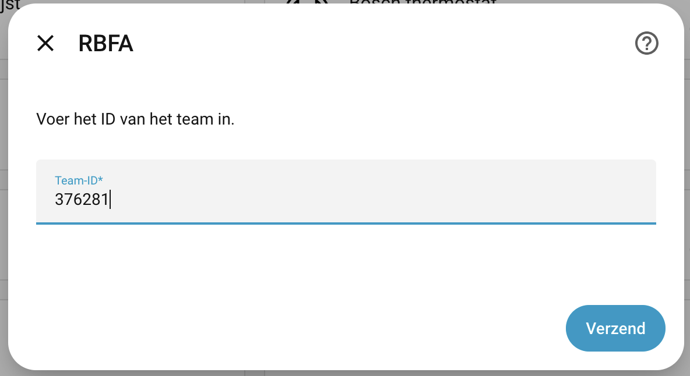
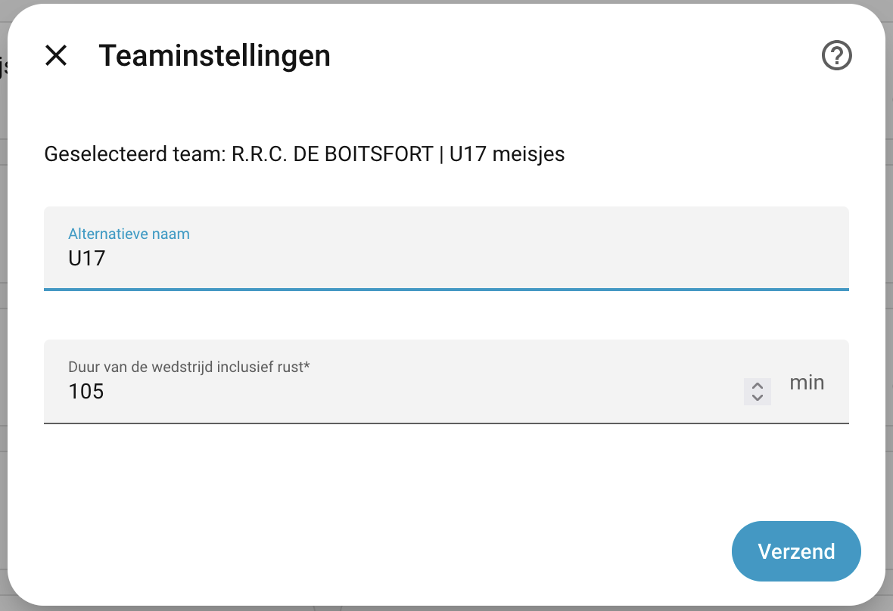
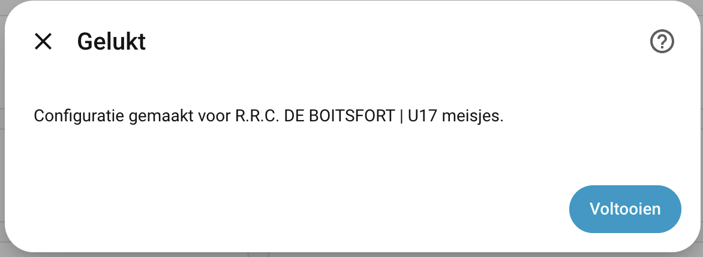
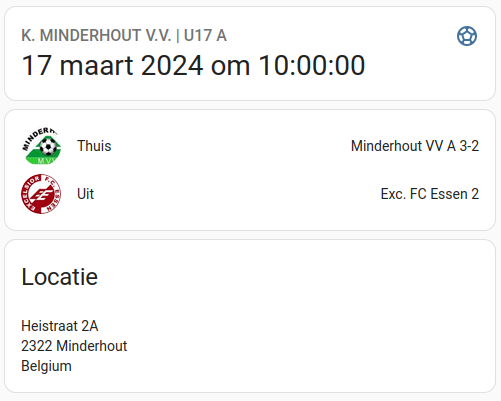
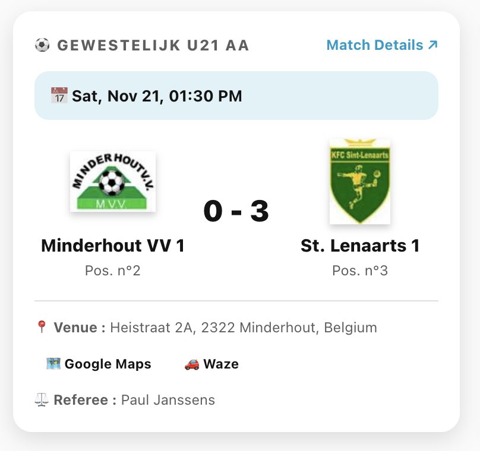
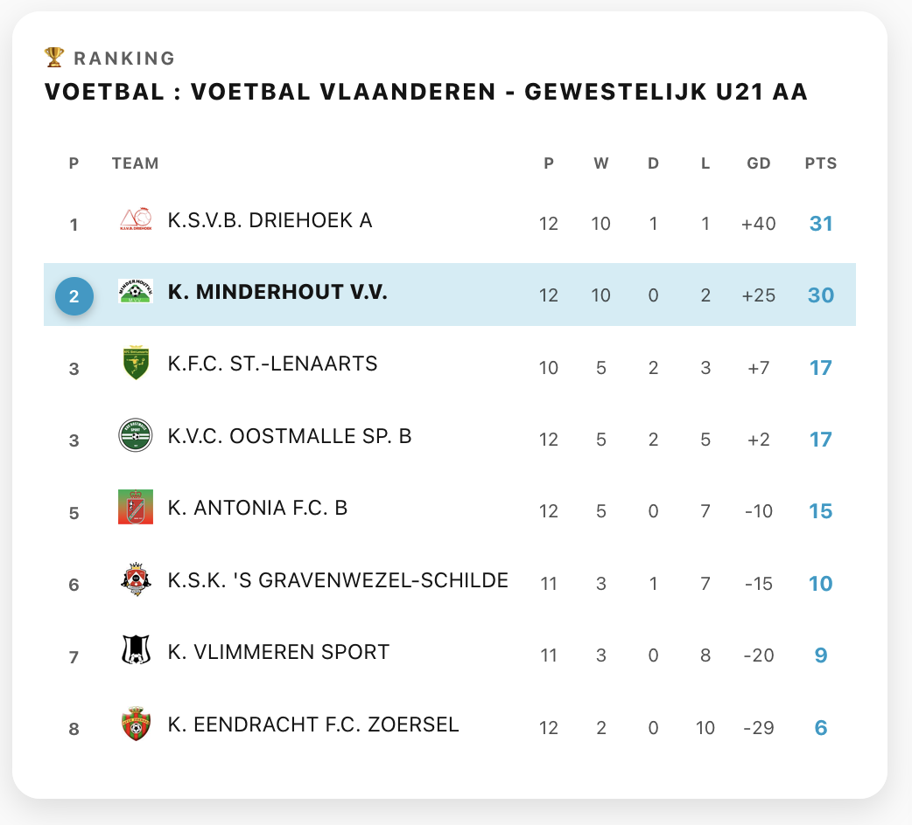

Add the calendar of your soccer team to Home Assistant. The data is gathered from the Royal Belgian Football Association ([RBFA](https://www.rbfa.be/)) website in cooperation with [Football Francophone Amateur](https://www.ffa.be/) and [Voetbal Vlaanderen](https://www.voetbalvlaanderen.be/).

[](https://github.com/rgerbranda/rbfa/actions/workflows/validate.yaml)
[](https://github.com/rgerbranda/rbfa/actions/workflows/hassfest.yaml)

[](https://my.home-assistant.io/redirect/hacs_repository/?owner=rgerbranda&repository=rbfa&category=integration)

## Add the integration

Install RBFA through **Settings → Marketplace** using the button above, then restart Home Assistant. Go to **Settings → Devices & services → Add integration**, search for **RBFA** and select it.

On Home Assistant versions before 2026.11, install the integration through HACS.

### 1. Enter the team ID

Open your team on the RBFA website and copy the team ID from its URL. In this example, the number after `ploeg/` is `300872`:

```text
https://www.rbfa.be/nl/club/2438/ploeg/300872/overzicht
```

Enter your own team ID and submit the form. The integration retrieves the team details before continuing.



### 2. Configure the team

Check the selected team shown at the top of the form. You can enter an optional alternative name and set the match duration in minutes, including half-time. The default duration is **105 minutes**. This duration is used to calculate the calendar end time and the time-based end of a match.

Submit the form to save these settings.



### 3. Complete setup

The confirmation screen shows the configured team. Select **Finish** to complete setup. The integration creates the calendar, upcoming and previous match sensors, and rankings sensor for this team.



You can change the alternative name and match duration later through the integration options. To add another team, repeat these steps with its team ID.

Example card
-


## Custom dashboard cards

Two custom cards provide three dashboard views: the upcoming match, the previous match and the rankings. They follow your Home Assistant profile language and support Dutch, English, French and Portuguese.

### Install the cards

Copy `www/match-card.js` and `www/ranking-card.js` from this repository into the `www` folder of your Home Assistant configuration directory (`/config/www` for a container installation).

In **Settings → Dashboards → ⋮ → Resources**, add both URLs as **JavaScript module** resources:

```text
/local/match-card.js?v=1
```

```text
/local/ranking-card.js?v=1
```

If Resources is hidden, enable Advanced mode in your user profile. Reload your browser after adding the resources. When updating the files, increase the `v` value and reload again to refresh the browser cache.

Alternatively, use these URLs to load the cards from GitHub through jsDelivr:

```text
https://cdn.jsdelivr.net/gh/rgerbranda/rbfa@main/www/match-card.js
```

```text
https://cdn.jsdelivr.net/gh/rgerbranda/rbfa@main/www/ranking-card.js
```

Register each card only once: choose either its local URL or its CDN URL. The CDN requires internet access and updates to `main` may be delayed by caching. Replace `@main` with a release tag to use a fixed version.

### Upcoming match


Add a Manual card with the following YAML. Replace `374444` with the team ID entered when configuring the integration:

```yaml
type: custom:match-card
baseid: "374444"
tag: upcoming
```

The card automatically finds the match sensors using their `baseid`, `tag` and `field` attributes. It shows a countdown or match status, team logos, venue, navigation links and referee. Scores and penalty shoot-out results appear when supplied by the integration. Team positions are retrieved from the matching series in the rankings sensor, when available.

### Previous match



Use the same team ID with `tag: lastmatch`:

```yaml
type: custom:match-card
baseid: "374444"
tag: lastmatch
```

This view shows the previous match and its available result, without a countdown.

For either match view, you can optionally set `langrbfaurl: nl`, `fr` or `en` to choose the language of the RBFA match-details link. This does not change the language of the card itself.

### Rankings



Replace `sensor.rangschikkingen` with the actual entity ID of your rankings sensor:

```yaml
type: custom:ranking-card
entity: sensor.rangschikkingen
```

The card displays the first available series and highlights your configured team. To select another series, add its `seriesId` as `series_id`:

```yaml
type: custom:ranking-card
entity: sensor.rangschikkingen
series_id: CHP_131142
```

Find the rankings sensor and its `series` attribute in **Developer tools → States**. Use the exact `seriesId` from your sensor; `CHP_131142` is an example. Each series contains its name and ranking. Match-card positions use the same series ID to avoid mixing rankings from different competitions.

Addresses are converted to coordinates using [Nominatim](https://nominatim.org/).
Location data: © [OpenStreetMap contributors](https://www.openstreetmap.org/copyright),
available under the [ODbL](https://opendatacommons.org/licenses/odbl/1-0/).


